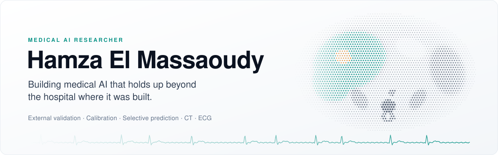

<picture>
  <source media="(prefers-color-scheme: dark)" srcset="assets/header-dark.svg">
  
</picture>

  <a href="mailto:elmassaoudy.hamza@gmail.com">elmassaoudy.hamza@gmail.com</a>
  &nbsp;·&nbsp;
  <a href="https://www.linkedin.com/in/hamza-elmassaoudy/">LinkedIn</a>
  &nbsp;·&nbsp;
  <a href="https://orcid.org/0009-0001-8118-7983">ORCID</a>

I am a medical AI researcher and a master's student in Computer Science at **Nanjing University of Information Science & Technology (NUIST)**.

A model that scores well on the data it was built on has passed only the first test. My work asks the next questions:

- Does it still work at another hospital, on another scanner, or on a noisier signal?
- Is it learning the disease, or a shortcut hidden in the data?
- When it is unsure, does it know to hand the case to a clinician?

**My focus is trustworthy medical AI:** external validation across sites and scanners, auditing datasets for shortcuts, calibrated confidence, and models that know when to defer to a human.

> **Looking for a PhD position in medical AI, starting September 2027.** I am also open to research and ML engineering roles in health AI.

## Research path

- **Multimodal medical imaging:** multiphase CT, radiomics and 3D deep learning, combined with clinical data.
- **Generalization:** testing models beyond the place where they were built, and finding the dataset shortcuts that make internal scores look better than they are.
- **Trustworthy decisions:** calibration, uncertainty, and selective prediction, so that uncertain cases go to clinicians.
- **Biosignals:** ECG foundation models for detecting atrial fibrillation.

## Work

- **Multimodal classification of primary liver tumors on multiphase CT:** paper under revision · [code](https://github.com/hamzaelmassaoudy/multimodal-liver-tumor-classification)
- **Trustworthy atrial fibrillation detection with ECG foundation models:** master's thesis and paper, in progress
- **Explainable HCC survival prediction:** [code](https://github.com/hamzaelmassaoudy/explainable-hcc-survival-prediction)

## Tools

- **Medical AI:** MONAI · SimpleITK · PyRadiomics · DICOM / NIfTI · WFDB · ECGFounder · ECG-JEPA · Grad‑CAM
- **Machine learning:** Python · PyTorch · scikit-learn · LightGBM · TensorFlow / Keras · NumPy · pandas · SciPy · OpenCV
- **Engineering:** Git · GitHub Actions · pytest · Docker · Linux · Streamlit · Django · Flask · Spring Boot · PHP · JavaScript · MySQL · PostgreSQL

## Beyond research

- **Co-founder of gethsk.com (coming soon):** a platform for learning Chinese through a structured, step-by-step learning path. I design the learning path and the courses, and write the code.
- **Freelance full-stack developer:** web systems for clients in Morocco, Saudi Arabia and the UAE, including [asiascholar.org](https://asiascholar.org).
- **Languages:** Arabic and Amazigh (native) · English (C1) · French (B1–B2) · Chinese (HSK 4).
